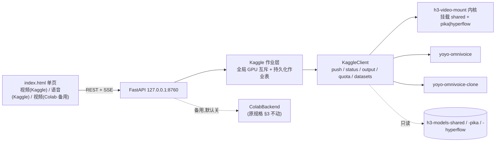
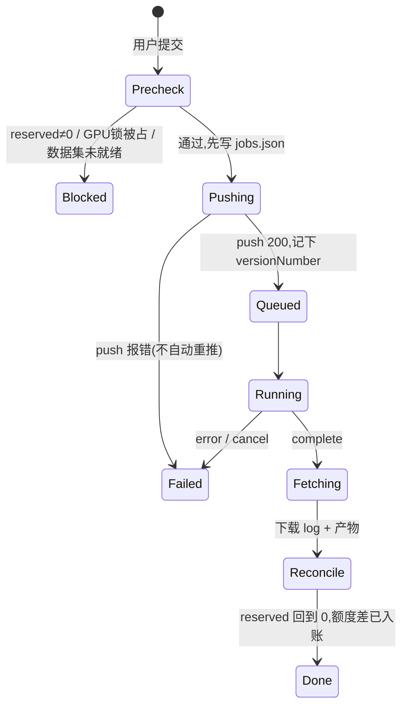
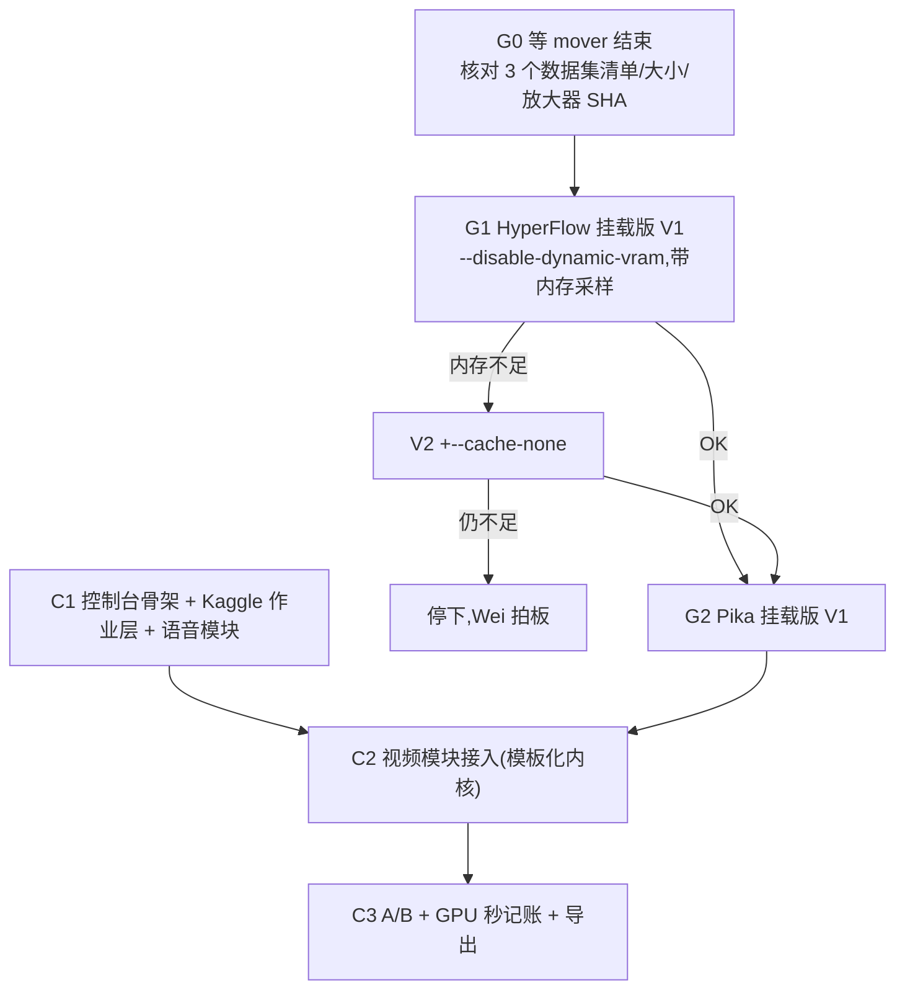

# H3 Kaggle 控制台整体方案（数据集挂载版 + `--disable-dynamic-vram`）

> 版本：策划稿 v1（2026-11-21 01:55），**仅方案，未改任何代码**。
> 定位：取代 [Kaggle-H3-Plan.md](file:///e:/demonyoyo/google-colab/Kaggle-H3-Plan.md) 第 9 节的执行顺序，并把「Kaggle H3 视频 + Kaggle OmniVoice 语音」统一并入本地控制台（127.0.0.1:8760）。[Colab-H3-Console-Spec.md](file:///e:/demonyoyo/google-colab/Colab-H3-Console-Spec.md) 中的 Colab 逻辑原样保留，作为备用后端。

---

## 0. 现状快照（本次只读核查）

| 项 | 实查结果 | 说明 |
|---|---|---|
| h3-model-mover 云端状态 | **`running`**，无 failureMessage | 01:54 用 `GET /kernels/status` 查了一次，**没有推送** |
| 私有数据集 `h3-models-*` | 列表查询**暂无结果** | 正常：mover 应该在每个数据集上传完成、最终提交时才创建/发版本。需等 mover 结束再核 |
| 本地轮询进程 | ⚠️ **有 2 个 `push_mover.py` 同时在跑**（PID 4540 用 .venv 的 Python，PID 9000 用系统 Python） | 两者都只轮询同一个 slug，不会再推送；但结束时会**同时往 `spike/_h3_mover_output/` 写文件**，可能互相覆盖。建议保留一个（见第 9 节 D1） |
| 本地 `_h3_mover_output/` | 是**上一版**的产物（`FAIL_UPLOAD_CHAIN`，探针文件大小不符） | 不代表 v10 的结果，别看错 |
| 首跑 h3_hyperflow_test | `FAIL_RUNS`：ComfyUI 在第 1 条运行时挂掉 | 日志能看到 `MiniMaxH3TEModel_ prepared for dynamic VRAM loading. 25140MB Staged`，`--lowvram` 被 dynamic VRAM（comfy-aimdo 0.6.0）接管后，编码器把内存撑满。另有一个次要问题：参考图槽位为空时报 `Is a directory: /tmp/ComfyUI/input`，脚本已自动回退处理 |
| `assets/` | `nodes/`、`refs/`、`workflows/` **三个目录都是空的** | 控制台要用的工作流 API JSON、YoYo 节点包和参考图，目前只以 base64 形式内嵌在内核脚本里 |
| OmniVoice 内核源码 | 句子和 instruct 都是写死的 Python 常量，**没有参数区标记** | 和规格 §12.1「按标记改写参数」的前提对不上，见第 5 节 |

---

## 1. 总体架构



核心设计原则：

1. **执行后端可插拔**：视频模块写成 `VideoBackend` 接口，有 `KaggleMountBackend`（主路）和 `ColabBackend`（备用）两个实现；Colab 默认关闭，在设置里开启后才显示对应页签。Colab 代码只保留规格书里的设计，本期**不实现**。
2. **Kaggle 作业层统一管理**：视频、语音（以及将来要重跑的 mover）共用**一把 GPU 锁、一张作业表**，在软件层面保证规格 §12.4 的「永不并发」。
3. **推送一次，状态可恢复**：每次推送前先写 `data/jobs.json`（slug、版本号、推送时间、参数指纹）。控制台重启后**只恢复轮询，绝不重推**，把这次「两个轮询进程」的情况从机制上杜绝。
4. **批量运行**：Kaggle 内核每次冷启动（装环境、起 ComfyUI、首次加载模型）成本固定，所以视频按「批」推送：一次推送跑 N 条提示词（默认 3 条，正好对应 A/B 协议），不做一条推一次。

---

## 2. 存储与挂载（目标态）

| 数据集 | 挂到哪个内核 | 内容 |
|---|---|---|
| h3-models-shared | 每个视频内核都挂 | 编码器（已改名）、两个 VAE、latent 放大器、taeh3 |
| h3-models-pika | Pika 批 | Cobijada Hybrid INT8 + Pika LoRA |
| h3-models-hyperflow | HyperFlow 批 | Flash 14B INT8 |

- 推送时 `datasetDataSources = ["demon820308/h3-models-shared", "demon820308/h3-models-<wf>"]`，`enableGpu=true`、机型 T4、`enableInternet=true`（安装 pip 和 git 节点包需要联网）。
- 内核里沿用 [h3_hyperflow_test_mount.py](file:///e:/demonyoyo/google-colab/h3_hyperflow_test_mount.py) 已有的做法：先递归按文件名定位、找不到直接 `FAIL_MOUNT`，再软链接进 `/tmp/ComfyUI/models/...`。挂载根路径不写死，Kaggle 新旧两种挂载布局都能兼容。
- 推送前控制台先做一遍**数据集就绪检查**：三个数据集状态为 ready，文件清单和大小与清单一致。不通过就不推送，免得白白消耗 GPU 秒。
- 硬规则照旧：`HF_HOME=/tmp/hf_cache`；`/kaggle/working` 只放 mp4 和 result.json。

---

## 3. 显存/内存策略：`--disable-dynamic-vram` 验证方案

**问题机理**：新版 ComfyUI 默认开启 dynamic VRAM（aimdo），会把模型权重「Staged」到内存里，再按需搬上显卡。这时 `--lowvram` 不起作用，25.1GB 的编码器加上 5GB 的 VAE 一起常驻内存（总共 31GiB、没有 swap），进程直接被杀。

**验证矩阵**（每档都是独立一次推送，前一档失败才推下一档，一次只改一个变量）：

| 档 | 启动参数 | 目的 |
|---|---|---|
| **V1（主验证）** | `--lowvram --disable-dynamic-vram` | 相对首跑只改这一个开关，验证经典模型管理能否在编码结束后释放编码器 |
| V2（V1 内存不足时） | V1 + `--cache-none` | 让编码器加载节点的输出在用完后释放（每条之间本来就重启服务，不影响计时口径） |
| V3（V2 仍不足时） | 停止，回报 Wei | 剩下的选项都要改工作流或换模型（比如换更小的编码器），属于重大分叉，必须 Wei 拍板 |

**V1 内核要补的可观测性**（这是验证能不能下结论的关键，不改任何工作流参数）：
- 后台内存采样线程：每 2 秒读一次 `/proc/meminfo`（MemAvailable）和 ComfyUI 进程的 RSS，写入 `result.json.mem_trace`，并记录各阶段的内存峰值。
- 解析 ComfyUI 日志里的 `loaded / unloaded / Staged` 行，生成一条模型装卸时间线，**直接证明编码器有没有被卸载**。
- 启动后先 grep 日志确认**不再出现** `prepared for dynamic VRAM loading`，否则判定参数没生效，记为 `FAIL_FLAGS`。
- 显存：`nvidia-smi` 每 5 秒记录两张卡的显存占用（ComfyUI 只用 cuda:0）。

**成功判据**：`HYPERFLOW_OK`、3 条产物都是 1472×832 / 158 帧 / 带音频、MemAvailable 全程最低值 > 1GiB（低于这个数在报告里标「临界」）。

启动参数做成内核参数区里的一个 `COMFY_FLAGS` 档位，由控制台下发；**界面只读显示，不提供自由编辑**，和「禁止顺手调参」的原则一致。

---

## 4. 视频模块（Kaggle 挂载版）

### 4.1 内核模板
- 把 `h3_hyperflow_test_mount.py` 泛化成一个模板 `kernels/h3_video_mount.py.tpl`，顶部有明确标记的参数区：
  `WORKFLOW (pika|hyperflow)`、`PROMPTS[]`、`SEED`、`REF_IMAGES_B64[3]`、`COMFY_FLAGS_PROFILE`、`RUN_LABEL`。
- 两套工作流的 API JSON、YoYo 两个节点包仍然 base64 内嵌；参考图由控制台按界面选择现场内嵌（单张建议 < 2MB，超过就在本地先压缩）。
- 只改规格 §5 定义的 6 处节点参数（2 / 31 / 39 / 40 / 62 / 83），这条不变。
- 新增的 Pika 版只是同一个模板换一个 `WORKFLOW` 值，不再单独维护一个脚本。

### 4.2 运行中能看到什么（限制要说清楚）
- Kaggle 脚本内核**运行过程中通常拿不到增量日志**（只有 status），日志和产物要等结束后经 `/kernels/output` 取回。**这一点要在 G1 时实测确认。**
- 所以界面的阶段进度分两级：运行中显示「推送 → 排队 → 运行中（已用时）」，结束后用 result.json 的 `phase_timings` 回填细分阶段（装环境 / 挂载 / 起服务 / 自检 / 第 1–N 条）。不伪造实时进度。

### 4.3 界面改动（相对规格 §4）
- **左列**「连接与部署」换成「环境与数据集」：Kaggle 账号、三个数据集的就绪灯（就绪 / 处理中 / 缺失，附文件数和总 GB）、内核模板版本、启动参数档位（只读）、[检查就绪]。原来的「一键部署 6 步」改成一次推送内部的阶段清单。
- **中列**：沿用规格 §4.3（工作流卡片、提示词、种子、3 个参考图槽位）；[生成一条] 改为 **[加入批次]**，再加一个 [推送本批]（1–3 条）。
- **右列**：历史和 A/B 沿用；记账口径从「Colab 单元」换成 **Kaggle GPU 秒**，结论写成「每周 30 小时额度约可生成 N 条（热机口径）」，并标注此数和 Colab 口径不能换算。
- 顶栏改成「H3 控制台」，常驻显示 **Kaggle 额度条（已用 / 108000 秒、reserved、周刷新时间）+ GPU 锁状态（空闲 / 被 视频·语音 占用）**。

---

## 5. 语音模块（Kaggle OmniVoice）

- 规格 §12 的参数、护栏、校验、历史**全部原样保留**。
- **需要拍板的偏差**：现有两个内核的源码里没有参数区标记（句子和 instruct 都是写死的常量）。建议做法：
  1. 从已拉取的源码派生出两个本地模板（`omnivoice_design.py.tpl` / `omnivoice_clone.py.tpl`），只把 `SENTENCES`、`INSTRUCT`、`SPEED`、`SILENCE`、参考音频 base64 这几处换成标记区，其余逻辑逐字不动；
  2. 推送到**原 slug**（`yoyo-omnivoice` / `yoyo-omnivoice-clone`）形成新版本，**不新建 slug、不改名**；
  3. 首次接入时先在本地对模板和线上源码做一次 diff，除标记区外有任何差异就停下报告。
- 共用第 1 节的 GPU 锁：视频批次运行期间语音按钮置灰，显示「视频批次占用中，预计结束时间」，反过来也一样。
- **全功能升级（P1–P5）**：新增 `kernels/omnivoice_unified.py.tpl`（单次加载模型 + Python API 复用 `VoiceClonePrompt`，原双模板保留作回退），支持 `design / clone / auto` 三模式、语言选择、固定时长 / 步数 / `normalize_text`、声线构建器、副语言标签与纠音提示、声音库 `.pt` 复用与 SRT 字幕导出；仍沿用原两个 slug，不新建 slug。

---

## 6. Kaggle 作业层（两个模块共用）



- 轮询间隔 20 秒；连续网络错误只记日志并退避，**不重推**。
- 控制台重启时：读 `jobs.json` 里未结束的作业，**只恢复轮询**。
- 额度对账：推送前和 reserved 回到 0 之后各读一次，差值记为本批 GPU 秒，再按条数分摊（冷启动那条单独列出）。
- `KaggleClient` 直接用 httpx 调 REST，Bearer token 从 `data/kaggle_token` 读取。这正是 `push_mover.py` 已经验通的那条路，正式代码只保留这一条（规格 §12.1 要求定版一条）。

---

## 7. 目录规划（实现阶段才创建）

```
server/      app.py · kaggle_client.py · jobs.py · video_kaggle.py · voice_kaggle.py · colab_backend.py(占位)
kernels/     h3_video_mount.py.tpl · omnivoice_unified.py.tpl · omnivoice_design.py.tpl · omnivoice_clone.py.tpl
web/         index.html
assets/      workflows/ · nodes/ · refs/        ← 现在是空的，从内嵌 base64 里还原出来
data/        settings.json · jobs.json · runs.json · voice_runs.json · voice_library.json · outputs/ · voice_outputs/ · voice_library/
start.bat
```
`spike/` 和根目录下现有的脚本、规格、zip 都保留不动。

---

## 8. 执行顺序与关卡



| 关卡 | 内容 | 通过标准 | 估计耗用 GPU |
|---|---|---|---|
| G0 | mover 跑完，只读核对 | `mover_result.json` 成功，3 个数据集文件齐全、大小一致 | 0（CPU 内核） |
| G1 | 用独立脚本推一次 HyperFlow 挂载版（不经控制台） | 见第 3 节成功判据 | 约 0.5–1.5 小时 |
| G2 | Pika 挂载版 | 同上，verdict `PIKA_OK` | 约 0.5–1.5 小时 |
| C1 | 控制台骨架 + 语音（**可以和 G0/G1 同步开工**，不依赖视频结论） | 设计、克隆各成功一条，§12.5 校验全部通过 | 约 2×10 分钟 |
| C2 | 视频接入控制台 | 界面推一批 3 条，结果和 G1/G2 一致 | 约 1 小时 |
| C3 | A/B 与结论 | 导出 JSON，给出「30 小时可跑 N 条」 | 约 2–3 小时 |

合计约 6–9 小时 GPU，占周额度三成以内。G1 和 G2 跑完之后，Kaggle-H3-Plan.md 第 9 节的「先测后建数据集」顺序作废（现实已经是先建数据集了），届时回填该文档，并在 Colab 规格书顶部加一行「Colab 后端：备用」注记。

---

## 9. 风险

| # | 风险 | 对策 |
|---|---|---|
| R1 | 关掉 dynamic VRAM 后，经典模式加载编码器仍需约 25GB 内存，余量只有几 GB | V1 → V2 两档逐级验证 + 内存采样证据；V3 必须 Wei 拍板，不硬撑 |
| R2 | 挂载 71GB 数据集会拉长内核启动 / 首次读取时间 | G1 记录「推送 → 开始运行」和挂载阶段耗时，计入冷启动成本 |
| R3 | 运行中拿不到实时日志 | 界面如实显示；G1 实测确认 |
| R4 | 数据集刚建好还在处理中，此时挂载会失败 | 推送前做就绪检查（第 2 节） |
| R5 | 两个本地轮询进程写同一个输出目录 | D1 处理；以后由作业层统一调度 |
| R6 | 参考图目前是占位渐变图 | Wei 提供真实的 3 张参考图放进 `assets/refs/`，否则计时有效但画面不代表实际效果 |

---

## 10. 待拍板

- **D1**：两个 `push_mover.py` 轮询进程保留哪一个？（建议保留 PID 4540（.venv），结束 PID 9000。我**不会擅自结束**，等你确认。）
- **D2**：验证矩阵是否同意「V1 只加 `--disable-dynamic-vram`」，还是为了省一次 GPU 额度，直接上 V2（同时加 `--cache-none`）？（建议先跑 V1，便于把原因归到单一变量上。）
- **D3**：OmniVoice 是否同意「派生模板 + 推送到原 slug 出新版本」（第 5 节）？
- **D4**：C1（控制台骨架 + 语音）是否在等 mover 和 G1 的同时就开工？
